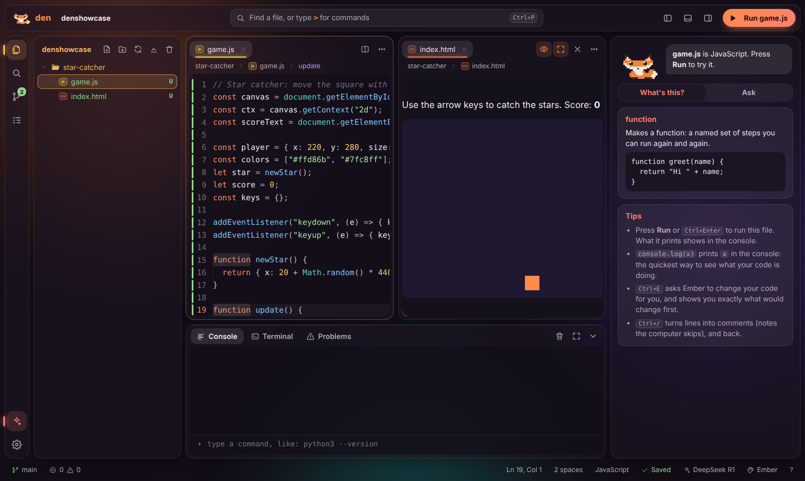

# den

A code editor that opens in your browser, made for learning. Type `den` in a
terminal and your project opens: your files on the left, your code in the
middle (one file, or two side by side), the console, terminals and problems
underneath, and Ember the fox on the right, explaining things in plain words.



It does what big editors do, without the settings maze:

- **Run** your code with one button (Python, JavaScript and about a dozen
  more). When something breaks, Ember says what it means, in plain words, and
  can **fix it with you**: she shows exactly what would change before anything does.
- **Mistakes show as you type.** A red squiggle under the problem, the line
  number in red, and the reason when you point at it (Python, JavaScript, JSON
  and CSS).
- **Real terminals**, built in: colours, arrow keys, `python3` on its own,
  `pip install`, `git`, anything.
- **Search and replace across every file**, with whole-word and pattern options.
- **Changes (git)**: see what changed since your last save point, line by
  line, commit with one button (Ember can write the message), and push to GitHub.
- **Two files side by side**, a map of the whole file, indent lines, matching
  brackets, other uses of the word you're on, and a path bar that shows which
  function you're in.
- **Live previews** of web pages, Markdown, SVG pictures and CSV tables.
- **Start from an example**: a web page, a Python program, a quiz, an arcade
  game you can play right away, or notes.
- **Edit with Ember** (⌘E): say what you want ("add a score that goes up")
  and look at the change before you accept it.
- **Nothing gets lost.** den saves as you type, keeps earlier versions of every
  file, and deleting only moves things to den's bin.
- Five colour themes (Ember, Dusk, Moss, Daylight, Frost) on see-through panes.

Part of the same family as [gossip](https://github.com/dpatel7-dev/gossip),
[Tree of Thought](https://github.com/dpatel7-dev/Tree-Of-Thought),
[pigeon](https://github.com/dpatel7-dev/pigeon),
[tidy](https://github.com/dpatel7-dev/tidy) and
[Project CLI Access](https://github.com/dpatel7-dev/Project-CLI-Access).
Its mascot is Ember, a fox (a den is where a fox lives).

## Install

The easiest way is Project CLI Access: type `pca`, pick **den**, press Enter.

Or on its own, on a Mac or Linux (Terminal):

```sh
curl -fsSL https://djp7.pythonanywhere.com/den/install.sh | sh
```

On Windows (PowerShell):

```powershell
irm https://djp7.pythonanywhere.com/den/install.ps1 | iex
```

If the website is blocked where you are, the same installer is on GitHub:

```sh
curl -fsSL https://raw.githubusercontent.com/dpatel7-dev/Den/main/install.sh | sh
```

den brings its own copy of Node.js if your computer doesn't have one, and
installs nothing else.

## Use it, step by step

1. Open a terminal.
2. Go to your project's folder. For example: `cd Documents/my-website`
   (or make a new one: `den my-first-project`, and den offers to make the folder).
3. Type `den` and press Enter.
4. den opens in its own window (or a browser tab). Keep the terminal open
   while you code: it's what den runs on. **Ctrl+C** in the terminal closes den.

The first page has examples to start from. Pick one and it's ready to run.

On Windows, use **Ctrl** wherever this says **⌘**.

### Finding your way around

| Where | What it's for |
| --- | --- |
| The bar at the top | **⌘P** finds a file by name. Type **>** for every command, **@** for the functions and headings in your file, **:** for a line number. |
| **Run** (top right) | Runs the file you're on (**⌘Enter**). For a web page it shows the preview. |
| The buttons on the left | **Files**, **Search** (in every file), **Changes** (git) and **Outline** (this file's functions). Click the one that's open to hide the side bar. |
| Under your code | **Console** (what your program prints, and a box to type commands), **Terminal** (**Ctrl+`**) and **Problems** (mistakes den spotted). |
| The right | Ember: **What's this?** explains the word your cursor is on and any error; **Ask** answers questions about your code. |
| The bottom line | Click the line number to jump to a line, the language to change colours, the branch to switch it, the mistakes count to see them. |

Handy keys: **⌘\\** two files side by side, **⌘D** select this word (again:
the next place it's used), **Alt+↑/↓** move lines, **⌘/** comment lines,
**F8** next mistake, **⌘E** edit with Ember. Press **?** for all of them.

### Files

Right-click a file or folder for everything you can do with it. Drag files
onto a folder to move them there, or drop files and folders from your computer
onto den to add them.

### Changes (git)

git keeps save points of your project, called commits. In **Changes**:

1. If den says so, press **Start tracking** (once per project).
2. Change some files. They're listed here, and the editor shows coloured bars
   beside the lines that changed (green: new, blue: changed, red: removed).
   Click a file to see exactly what changed.
3. Write a few words about what you did (or press **Write it for me**), then
   **Commit**.
4. **Put on GitHub** connects the project to a repository on github.com, and
   the arrows send and fetch commits.

Undoing changes is safe: new files go to den's bin, and den keeps a copy of
the rest in their earlier versions.

## Ember's AI (optional, free)

The "What's this?" help, the mistake squiggles and the error explanations work
without any AI. To also ask Ember questions, and have her edit code with you,
set up free AI once in Tree of Thought:

1. Install Tree of Thought (type `pca` and pick it).
2. In a terminal, type `tot free` and follow the steps (it's copy and paste).
3. In den, open the **Ask** tab. That's it.

The AI runs in the cloud, so nothing heavy runs on your computer. Ember only
suggests: when she writes code, **Apply** shows you exactly what would change
(green added, red removed) before anything does, and **⌘Z** undoes it.

## Running code

den runs the file you're on with the right program for its kind, from the
folder that file is in:

| Files | Needs |
| --- | --- |
| `.py` | Python ([python.org](https://www.python.org/downloads)) |
| `.js` | Node.js (den's installer brings one) |
| `.html` `.md` `.svg` `.csv` | nothing: they preview in den |
| `.sh` | Mac or Linux |
| `.ps1` | PowerShell (Windows) |
| `.rb` `.php` `.lua` `.go` `.java` `.swift` `.dart` `.r` `.pl` | that language installed |
| `.c` `.cpp` | a compiler (on a Mac: `xcode-select --install`) |

If something isn't installed, den says what to get and where. The box under
the console also runs any command, like `pip install requests` or `npm install`.

## Safe by design

- den only listens on your own computer, and its address has a long secret in
  it. Other websites you visit can't reach it, and it refuses requests that
  don't come from den's own page.
- It only touches files inside the folder you opened (links that point outside
  are refused too).
- Your web pages preview from a separate address, so a page can't reach den's
  controls.
- It never runs anything unless you press Run, type a command, or use a
  terminal. Terminals are closed when no den page has been open for a few minutes.
- Deleting moves things to den's bin (`~/.den/bin`), and every save keeps the
  version before it (`~/.den/history`, the newest 25 per file).

## Commands

```
den                  open the folder you're in
den <folder>         open that folder (den offers to make it if it isn't there)
den <file>           open the folder a file is in, showing that file
den update           get the newest version
den version          which version this is
den uninstall        remove den (add "all" to remove its bin and saved versions too)
den help             this list

--tab                a browser tab instead of den's own window
--no-open            just print the address
--port <n>           use this port
```

## For developers

Zero dependencies: Node.js 18 or newer, nothing from npm. The page is plain
HTML, CSS and JavaScript in `web/`.

```sh
node bin/den.js ~/some/project     # try it
node --test                        # the tests
```

| File | What it does |
| --- | --- |
| `src/server.js` | the local server: files, running, git, terminals, checks, Ember |
| `src/files.js` | reading and saving inside the folder, the bin, earlier versions, search and replace |
| `src/git.js` | git, through the real `git` program |
| `src/term.js` | terminals (a real pty from the `script` program on Mac and Linux) |
| `src/check.js` | spotting mistakes with Python's and Node's own checkers |
| `web/den.js` | the page: groups of tabs, saving, running, previews, Ember |
| `web/views.js` | files, search, changes, outline, problems, terminals |
| `web/editor.js` | the editor (a textarea under a coloured copy, plus the minimap and the rest) |
| `web/term.js` | the terminal screen (colours, cursor movement, full-screen programs) |
| `web/diff.js` | comparing two versions line by line |
| `web/highlight.js` | colouring about 25 languages |
| `web/icons.js` | the icons (drawn, never emoji) |

MIT licence.
